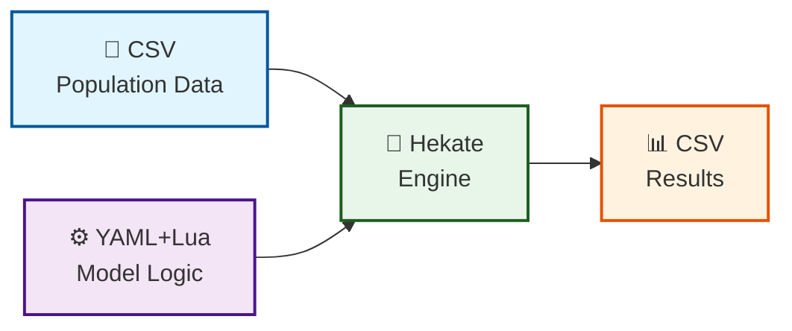

<div align="left">
  
  <p><em>Hekate — Microsimulation Engine</em></p>
</div>

# Hekate — Microsimulation Engine

Named after the Greek goddess of crossroads, magic, and transitions, Hekate is a self-contained, dynamically configurable demographic microsimulation system written in Go. **Hekate is a general-purpose microsimulation engine** that can simulate population dynamics including migration, aging, mortality, fertility, and other demographic processes. The name reflects the engine's purpose—guiding populations through the crossroads of life events and demographic transitions.

---

## Contents

- [Why Hekate?](#why-hekate)
- [⚡ Try It in 5 Minutes](#-try-it-in-5-minutes)
- [What Next?](#what-next)
- [How Hekate Works](#how-hekate-works)
- [Overview](#overview)
- [Using Hekate](#using-hekate)
  - [Configuration](#configuration)
  - [Input Data Format](#input-data-format)
  - [Output](#output)
  - [Pre-Flight Validation](#pre-flight-validation)
- [Features](#features)
  - [Reproducibility](#reproducibility-guarantees)
  - [Streaming Mode](#-streaming-mode-for-large-populations)
  - [Statistical Toolkit](#built-in-statistical-functions)
- [Performance Benchmarks](#performance-benchmarks)
- [Troubleshooting](#troubleshooting)
- [Compiling from Source](#compiling-from-source)
- [Codebase Structure](#codebase-structure)
- [Extending Hekate](#extending-hekate)
- [Population Generator Script](#population-generator-script)
- [Get Help from AI](#get-help-from-ai-with-the-llm-prompt-template)
- [License](#license)
- [Authors](#authors)

---

## Why Hekate?

### Think NetLogo for Big Data

If you've used **NetLogo**, you already understand Hekate's philosophy:

| Feature | NetLogo | Hekate |
|---------|---------|--------|
| Single download, everything included | ✅ | ✅ |
| Easy to learn, shallow learning curve | ✅ | ✅ |
| Build models without programming experience | ✅ | ✅ |
| Rapid iteration: edit → run → see results | ✅ | ✅ |
| Domain-specific language (not general-purpose) | ✅ | ✅ |
| Built-in functions for common tasks | ✅ | ✅ |

**The Hekate Promise:** Like NetLogo, you can go from zero to a working model in minutes. Unlike NetLogo, Hekate can scale to millions or billions of individuals with minimal memory — and every result is reproducible.

### The Problem We're Solving

Traditional microsimulation systems have a fundamental problem: **to change how the model behaves, you need to change the source code and recompile.** This means:

- Only programmers can modify models
- Each change requires a new software release
- Models are locked inside compiled binaries
- Collaboration is difficult

### Our Solution: Models as Data

Hekate takes a different approach. **Models are defined as data, not code.**



| Traditional Approach | Hekate Approach |
|----------------------|----------------|
| Model is code | Model is data (YAML + Lua) |
| Change = recompile | Change = edit text file |
| Programmers only | Anyone can modify |
| One model per release | Many models in one binary |
| Models are hidden | Models are transparent |
| Hard to share | Easy to share |

### The Three Components

**1. CSV Files: Your Population Data**

Your population is stored as a simple CSV file. Each row is one person, each column is a characteristic (age, sex, area, etc.). Hekate automatically detects your columns — no configuration needed.

**2. YAML + Lua: Your Model Instructions**

Your model is defined in a YAML file with embedded Lua scripts:
- **YAML** configures the simulation (iterations, file paths, etc.)
- **Lua** defines the logic (how people age, die, move, etc.)

The Lua scripts are the "brain" of your model. They tell Hekate what to do with your population.

**3. Hekate Engine: The Interpreter**

Hekate is a single, self-contained executable that:
- Reads your CSV population
- Reads your YAML model instructions
- Executes the Lua scripts on your population
- Produces CSV results

### Why This Works

**For Non-Programmers:**
- You only need to learn a few simple Lua concepts
- Models read like plain English
- No compilation, no complex setup

**For Researchers:**
- Rapid iteration: edit and rerun in seconds
- Full transparency: the model is visible in the config
- Easy collaboration: share config files, not code
- Reproducible: verify others' results independently

**For Developers:**
- One binary for all models
- No dependency management
- Easy distribution
- Modular codebase

---

## ⚡ Try It in 5 Minutes

No installation. No compilation. Just download and run.

### Step 1: Download the Binary

Pick the binary for your platform from the [latest release](https://github.com/your-repo/hekate/releases/latest):

| Platform | Download |
|----------|----------|
| **Linux** (x86_64) | [`hekate-linux-amd64`](https://github.com/ricci-colasanti/Hekate/raw/main/hekate-linux-amd64) |
| **Linux** (ARM64) | [`hekate-linux-arm64`](https://github.com/ricci-colasanti/Hekate/raw/main/hekate-linux-arm64) |
| **macOS** (Apple Silicon — M1/M2/M3/M4) | [`hekate-darwin-arm64`](https://github.com/ricci-colasanti/Hekate/raw/main/hekate-darwin-arm64) |
| **macOS** (Intel) | [`hekate-darwin-amd64`](https://github.com/ricci-colasanti/Hekate/raw/main/hekate-darwin-amd64) |
| **Windows** (x86_64) | [`hekate-windows-amd64.exe`](https://github.com/ricci-colasanti/Hekate/raw/main/hekate-windows-amd64.exe) |

> **Not sure which macOS binary you need?** Open Terminal and run `uname -m`:
> - `arm64` → use `hekate-darwin-arm64`
> - `x86_64` → use `hekate-darwin-amd64`

Make the binary executable (Linux/macOS only):

```bash
chmod +x hekate-*
```

### Step 2: Save the Example Files

Create a new folder and save these two files inside it.

**`population.csv`** — a small starting population:

```csv
person_id,age,sex,area_id,alive
1,25,F,1,true
2,30,M,1,true
3,45,F,1,true
4,68,M,1,true
5,82,F,1,true
6,2,M,1,true
7,15,F,1,true
8,35,M,1,true
9,55,F,1,true
10,70,M,1,true
```

**`config.yaml`** — a simple aging + mortality model:

```yaml
simulation:
  iterations: 5
  population_file: "population.csv"
  output_file: "output.csv"
  random_seed: 42
  verbose: true
  id_column: "person_id"

models:
  - name: "aging"
    type: "lua_model"
    priority: 1
    enabled: true
    description: "Increment everyone's age by 1 year"
    parameters:
      script: |
        function transition(population, params)
          for _, person in ipairs(population) do
            if person.alive == true or person.alive == "true" then
              person.age = (tonumber(person.age) or 0) + 1
            end
          end
          return population
        end

  - name: "mortality"
    type: "lua_model"
    priority: 2
    enabled: true
    description: "Age-based mortality"
    parameters:
      script: |
        function transition(population, params)
          for _, person in ipairs(population) do
            if person.alive == true or person.alive == "true" then
              local age = tonumber(person.age) or 40
              if hekate_stats.logistic_draw(-6.0, 0.09, age) then
                person.alive = false
              end
            end
          end
          return population
        end
```

> **Note on `id_column`:** Hekate requires you to specify an ID column that contains unique values for each individual. This determines the order of rows in the output CSV, making results easier to compare across runs. It must match a column in your CSV exactly.

### Step 3: Run It

From inside that folder:

```bash
# Linux
./hekate-linux-amd64 config.yaml

# macOS (Apple Silicon)
./hekate-darwin-arm64 config.yaml

# macOS (Intel)
./hekate-darwin-amd64 config.yaml

# Windows
hekate-windows-amd64.exe config.yaml
```

You should see something like this:

```
═══ Hekate: Microsimulation Engine ═══
Iterations: 5
Population file: population.csv
ID column: person_id
Mode: BULK (load all into memory)
Random seed: 42
Models loaded: 2
Enabled models: 2
  - aging (priority: 1)
  - mortality (priority: 2)

════════════════════════════════════════════════════════
  Lua Script Pre-Flight Validation
════════════════════════════════════════════════════════

  ✅ aging                          (priority: 1)
  ✅ mortality                      (priority: 2)

════════════════════════════════════════════════════════
  ✅ All 2 models validated successfully
════════════════════════════════════════════════════════

════════════════════════════════════════════════════════
  Runtime Validation: Column Names vs CSV
════════════════════════════════════════════════════════

  CSV columns: person_id, age, sex, area_id, alive

  ✅ aging                          (priority: 1)
  ✅ mortality                      (priority: 2)

════════════════════════════════════════════════════════
  ✅ All 2 models reference valid columns
════════════════════════════════════════════════════════

--- Using Bulk Processing (load all into memory) ---
Loaded 10 individuals with 5 columns

═══ Iteration 1/5 ═══
  ▶ aging
  ▶ mortality
...

═══ Simulation Complete ═══
Results saved to output.csv
```

### Step 4: Open the Result

Open `output.csv` in any spreadsheet app or text editor. You'll see the same 10 people, but **5 years older** — and some will have died:

```csv
person_id,age,sex,area_id,alive
1,30,F,1,true
2,35,M,1,true
3,50,F,1,true
4,73,M,1,true
5,87,F,1,false   ← died
6,7,M,1,true
7,20,F,1,true
8,40,M,1,true
9,60,F,1,true
10,75,M,1,true
```

**That's it.** You've just run a demographic microsimulation in under 5 minutes.

### ✅ Verify Reproducibility

Run it again — you'll get the exact same output:

```bash
./hekate-linux-amd64 config.yaml
cp output.csv run1.csv
./hekate-linux-amd64 config.yaml
cp output.csv run2.csv
diff run1.csv run2.csv   # no differences, ever
```

Try changing `random_seed: 42` to `random_seed: 999`. Different results — but still reproducible.

### Using Streaming Mode

If your population is large (> 1 million people) or your CSV is sorted by an area column, you can enable streaming mode in your config:

```yaml
simulation:
  streaming_mode: true
  area_column: "area_id"  # CSV must be sorted by this column
```

See [Streaming Mode](#-streaming-mode-for-large-populations) for details.

---


### Tutorials

Get started with Hekate through our step-by-step tutorials. Each tutorial builds on the previous one, taking you from beginner to advanced user.

| Tutorial | Description | Level |
|----------|-------------|-------|
| [Tutorial 1: Building an Aging Model](tutorials/tutorial1_aging.md) | Learn the basics by creating a simple aging model. You'll create a population CSV, write your first configuration, run the simulation, and analyze the output. | ⭐ Beginner |
| [Tutorial 2: Understanding YAML and Adding Mortality](tutorials/tutorial2_yaml_mortality.md) | Dive deeper into YAML rules. Learn how to add a mortality model with age-specific death probabilities and track population changes. | ⭐⭐ Intermediate |
| [Tutorial 3: Adding Fertility](tutorials/tutorial3_fertility.md) | Complete the demographic cycle by adding fertility. Learn how to create new individuals (births), assign their characteristics, track population growth, and understand the full demographic cycle of aging, mortality, and fertility. | ⭐⭐⭐ Advanced |
| [Tutorial 4: Regression and Statistical Functions](tutorials/totorial_4_regression.md) | Learn how to use Hekate's statistical toolkit — linear regression, logistic regression, Poisson regression, and softmax — to build realistic models of income, health, education, and fertility. | ⭐⭐⭐ Advanced |
| [Tutorial 5: Large-Scale Simulations with Streaming Mode](tutorials/totorial_5_streaming.md) | Learn how to use Hekate's streaming mode to simulate populations of millions to billions of people with minimal memory. Includes performance tuning, area-based processing, and best practices for large-scale runs. | ⭐⭐⭐⭐ Advanced User |
| [Tutorial 6: Using Hekate's Statistical Toolkit](tutorials/tutorial_6_stats.md) | Build regression-based models from published coefficients — linear for income, logistic for mortality, Poisson for fertility, softmax for education. Includes a complete worked example combining all four techniques. | ⭐⭐⭐⭐ Advanced |


---

## How Hekate Works

Hekate is a **general-purpose microsimulation engine** that models population dynamics through individual-level simulation. Unlike traditional microsimulation systems that require code changes for each new model, Hekate uses:

- **Lua scripts** for model logic (flexible and readable)
- **YAML configuration** for model parameters, migration rates, and execution order
- **CSV files** for population data (works with any column structure)
- **Pure Go data structures** for in-memory processing (no external dependencies)

The result is a single, self-contained executable that can be distributed and run on any system without installation requirements. **Hekate can model a wide range of demographic processes** including migration, aging, mortality, fertility, education, income, household formation, and more.

---

## Overview

Hekate is a **general-purpose microsimulation engine** that models population dynamics through individual-level simulation.

### General Microsimulation Capabilities

- **Age-Specific Models**: Different transition probabilities for different age groups
- **Flexible Model Logic**: Easily modify or add new models through YAML configuration
- **Priority-Based Execution**: Models run in specified priority order
- **Dynamic Data Handling**: Automatically detects and adapts to any CSV column structure
- **8 Built-in Statistical Functions**: Linear, logistic, Poisson, softmax regression plus sampling functions

### Example Models

Hekate can model a wide range of demographic processes. Here are some examples:

**Migration Model** — People move between areas based on age-specific probabilities. Young adults are most mobile, elderly are least mobile.

**Fertility Model (Using Poisson Draw)** — Women of childbearing age sample their number of children from a Poisson distribution:

```lua
if person.sex == "F" and age >= 15 and age <= 50 then
    local children = hekate_stats.poisson_draw(
        -1.5,
        0.05, age,
        0.5, married_score
    )
    person.parity = children
end
```

**Mortality Model (Using Logistic Draw)** — People die based on age-specific death probabilities:

```lua
if hekate_stats.logistic_draw(
    -3.5,
    1.2, age / 10,
    0.8, bmi_score
) then
    person.alive = false
end
```

**Education Model (Using Softmax + Categorical Draw)** — Children transition through education levels:

```lua
local probs = hekate_stats.softmax_predict(
    {0.5, 0.1, age, -0.2, parent_edu},
    {1.0, 0.3, age, 0.5, parent_edu},
    {0.2, 0.5, age, 0.8, parent_edu}
)
local idx = hekate_stats.categorical_draw(probs[1], probs[2], probs[3])
person.education = ({"primary", "secondary", "tertiary"})[idx]
```

**Income Model (Using Linear Regression)** — People earn income based on age, education, and sex:

```lua
person.income = hekate_stats.linear_predict(
    coefs.intercept,
    coefs.age, person.age,
    coefs.education, edu_score,
    coefs.gender, gender_score
)
```

**Health Risk Model (Using Logistic Regression)** — Health risk is calculated using logistic regression with multiple risk factors:

```lua
local risk = hekate_stats.logistic_predict(
    coefs.intercept,
    coefs.age, age / 10,
    coefs.bmi, bmi_score,
    coefs.smoker, smoker_score
)
```

**Household Formation Model** — Young adults form new households, children live with their parents.

---

## Using Hekate

### Configuration

The system is entirely configured through a single YAML file.

#### Simulation Parameters

```yaml
simulation:
  iterations: 10                    # Number of years to simulate
  population_file: "population.csv" # Input CSV file
  output_file: "output.csv"         # Output CSV file
  random_seed: 42                   # Fixed random seed for reproducibility
  verbose: true                     # Detailed logging output
  id_column: "person_id"            # REQUIRED: Primary key column for ordering
  area_column: "area_id"            # REQUIRED for streaming mode: Column to group by
  streaming_mode: true              # Enable streaming area-by-area processing
  strict_mode: false                # Treat validation warnings as errors (CI)
  skip_validation: false            # Disable pre-flight Lua validation
```

| Setting | Description | Default |
|---------|-------------|---------|
| `iterations` | Number of years to simulate | Required |
| `population_file` | Input CSV file path | Required |
| `output_file` | Output CSV file path | Required |
| `random_seed` | Base seed for reproducible randomness | Required for reproducibility |
| `verbose` | Detailed logging output | `false` |
| `id_column` | Primary key column for ordering output | Required |
| `area_column` | Column to group by (streaming mode only) | Required if streaming |
| `streaming_mode` | Enable area-by-area processing | `false` |
| `strict_mode` | Treat validation warnings as errors | `false` |
| `skip_validation` | Skip pre-flight Lua and column validation | `false` |
| `validation_log_file` | Path to write the failure report | `hekate_validation.log` |

**When to use streaming mode:**
- Population > 1 million
- Limited memory available
- Large number of areas
- Running on low-cost hardware

#### Model Definitions

Models define demographic transitions using Lua scripts. Each model has:

| Field | Description |
|-------|-------------|
| `name` | Identifier for the model |
| `type` | Currently only `"lua_model"` is supported |
| `priority` | Execution order (lower runs first) |
| `enabled` | Whether to run this model |
| `description` | Human-readable description |
| `parameters.script` | The Lua `transition(population, params)` function |

Here's a complete example with multiple models:

```yaml
models:
  - name: "aging"
    type: "lua_model"
    priority: 1
    enabled: true
    parameters:
      script: |
        function transition(population, params)
          for _, person in ipairs(population) do
            if person.alive == true or person.alive == "true" then
              person.age = tonumber(person.age) + 1
            end
          end
          return population
        end

  - name: "mortality"
    type: "lua_model"
    priority: 2
    enabled: true
    parameters:
      script: |
        function transition(population, params)
          for _, person in ipairs(population) do
            if person.alive == true or person.alive == "true" then
              local age = tonumber(person.age) or 40
              if hekate_stats.logistic_draw(
                -4.0,
                0.08, age
              ) then
                person.alive = false
              end
            end
          end
          return population
        end

  - name: "fertility"
    type: "lua_model"
    priority: 3
    enabled: true
    parameters:
      script: |
        function transition(population, params)
          for _, person in ipairs(population) do
            if (person.alive == true or person.alive == "true") and person.sex == "F" then
              local age = tonumber(person.age) or 30
              if age >= 15 and age <= 50 then
                local children = hekate_stats.poisson_draw(
                  -1.5,
                  0.05, age
                )
                person.parity = (tonumber(person.parity) or 0) + children
              end
            end
          end
          return population
        end
```

### Input Data Format

The system accepts any CSV file with a header row. Column types are automatically detected.

#### Required Columns
- `person_id`: Unique identifier (must match `id_column` in config)
- `age`: Age in years
- `area_id`: Current geographic area (integer or string)
- `alive`: Boolean indicating if individual is alive

#### Recommended Columns
- `previous_area`: Previous geographic area (initialized to 0 or -1)
- `sex`: Gender (M/F) — needed for gender-specific models
- `partner_id`: Partner's person_id (0 if none)

#### ID Column

Hekate requires you to specify an **ID column** in the configuration. This column:
- Must contain unique values for each individual
- Is used as the PRIMARY KEY
- Determines the order of rows in the output CSV

**Why is this required?** Hekate uses the ID column to ensure consistent ordering of output data, making it easier to compare results across different runs and to verify reproducibility.

```yaml
simulation:
  id_column: "person_id"  # Must match a column in your CSV
```

#### Example CSV

```csv
person_id,age,sex,area_id,alive,previous_area
1,25,F,1,true,0
2,30,M,1,true,0
3,45,F,1,true,0
4,68,M,2,true,0
5,82,F,2,true,0
```

#### Sorting for Streaming Mode

**IMPORTANT:** For streaming mode to work, your CSV must be **sorted by `area_column`**:

```
area_id 1: person 1, person 2, person 3, ...
area_id 2: person 101, person 102, person 103, ...
area_id 3: person 201, person 202, person 203, ...
```

**How to sort your CSV:**

Using Python:
```python
import pandas as pd
df = pd.read_csv('population.csv')
df_sorted = df.sort_values('area_id')
df_sorted.to_csv('population_sorted.csv', index=False)
```

Using command line (Linux/macOS):
```bash
(head -n1 population.csv && tail -n+2 population.csv | sort -t, -k4 -n) > population_sorted.csv
```

### Output

#### CSV Output
The final population state is saved as CSV with all columns preserved, including:
- Original columns (person_id, age, sex, area_id, alive)
- Migration history (previous_area)
- Additional columns added by models

**Note:** The output CSV is always ordered by the ID column specified in the configuration.

#### Intermediate Files (Streaming Mode)
When running in streaming mode, Hekate creates intermediate files for each year:

```
year_0.csv  → Initial population (input)
year_1.csv  → After year 1
year_2.csv  → After year 2
year_3.csv  → After year 3
...
final_output.csv → Copy of last year's file
```

These files allow you to:
- Resume simulations from any year
- Check intermediate results
- Debug models more easily

### Pre-Flight Validation

Before running any simulation, Hekate performs **two-stage validation** to catch common mistakes in milliseconds — saving you from hours of wasted computation.

#### Why This Matters

Imagine running a 10-million-person, 50-year simulation (2.3 hours). If your Lua script has a typo like `person.agge`, the run will fail at year 47 — after **2.3 hours of wasted compute**. With pre-flight validation, it fails in **2 milliseconds**.

#### Stage 1: Lua Syntax Validation

Hekate compiles every Lua script in a throwaway VM and checks:

- ✅ **Syntax is valid** — no missing `end` keywords, unbalanced brackets, etc.
- ✅ **A `transition` function exists** — the entry point Hekate needs
- ⚠️ **Common mistakes** — using `#` for comments, calling `math.randomseed()`

#### Stage 2: Column Name Validation

Hekate scans every script for `person.COLUMN` references and compares them against your CSV header. It catches:

- ❌ **Typos in column names** — `person.agge` (suggests `person.age`)
- ❌ **Columns that don't exist** — `person.income` when there's no income column
- ❌ **Case sensitivity issues** — `person.Age` when the CSV has `age`

When a typo is found, Hekate suggests the closest matching column using fuzzy matching:

```
❌ mortality                      (priority: 2)
     └─ column 'agge' not found (did you mean 'age'?)
```

#### What the Output Looks Like

**Successful validation:**

```
════════════════════════════════════════════════════════
  Lua Script Pre-Flight Validation
════════════════════════════════════════════════════════

  ✅ aging                          (priority: 1)
  ✅ mortality                      (priority: 2)

════════════════════════════════════════════════════════
  ✅ All 2 models validated successfully
════════════════════════════════════════════════════════

════════════════════════════════════════════════════════
  Runtime Validation: Column Names vs CSV
════════════════════════════════════════════════════════

  CSV columns: person_id, age, sex, area_id, alive

  ✅ aging                          (priority: 1)
  ✅ mortality                      (priority: 2)

════════════════════════════════════════════════════════
  ✅ All 2 models reference valid columns
════════════════════════════════════════════════════════
```

**With a typo:**

```
  ❌ mortality                      (priority: 2)
       └─ column 'agge' not found (did you mean 'age'?)

════════════════════════════════════════════════════════
  ❌ 1 of 2 models reference missing columns (1 total)
════════════════════════════════════════════════════════

📄 Detailed report written to: hekate_validation.log
Simulation aborted: 1 model(s) reference missing columns
```

#### Suppressing False Positives

If a column is added by an **earlier model** in the pipeline, the validator will flag it as missing. To suppress the warning, add a special comment to your script:

```lua
function transition(population, params)
  -- hekate:allow-columns income, tax_bracket
  for _, person in ipairs(population) do
    if person.income > 50000 then
      -- ...
    end
  end
  return population
end
```

The validator will skip warnings for columns listed in the comment.

#### The Validation Log

When validation fails, Hekate writes a detailed report to `hekate_validation.log`:

```
Hekate — Lua Script Validation Report
======================================

Summary:
  Total models:    2
  Valid models:    1
  Failed models:   1
  Total warnings:  0

Details:
--------

[✅ PASS] aging

[❌ FAIL] mortality
  Error: <string> line 5: 'end' expected (to close 'function' at line 1) near '<eof>'
       💡 Check that every 'function', 'if', 'for', and 'while' has a matching 'end'.

Next steps:
  1. Fix the errors listed above in your config.yaml
  2. Re-run Hekate to verify
  3. If the error message is unclear, see:
     - README.md section 'Troubleshooting'
     - LLM_PROMPT_TEMPLATE.md for AI-assisted help
```

---

## Features

### Reproducibility Guarantees

**Hekate produces scientifically reproducible results.** When you set a `random_seed` in your configuration, running the same simulation twice will produce byte-for-byte identical output, no matter when, where, or how many times you run it.

#### The Promise

```bash
# Run 1
./hekate config.yaml
cp output.csv run1.csv

# Run 2 (days later, on a different machine)
./hekate config.yaml
cp output.csv run2.csv

# Result:
diff run1.csv run2.csv
# (no output - files are identical)
```

#### Why Reproducibility Matters

- **Scientific research**: Other researchers can verify your results
- **Debugging**: You can reliably reproduce bugs
- **Validation**: You can compare model versions objectively
- **Collaboration**: Your colleagues get the same results as you
- **Peer review**: Reviewers can independently verify your findings

#### How It Works

Hekate uses a **dedicated random number generator (RNG)** for each Lua VM instance, seeded deterministically for each model execution:

```
seed = random_seed + (iteration × 1000) + model_index
```

This ensures:
1. **No dependency on system time** or global random state
2. **Independent randomness** between different models
3. **Fully reproducible** results across runs, machines, and time

#### Requirements for Reproducibility

For reproducible results, you must:

| Requirement | Why |
|-------------|-----|
| **Set `random_seed` in config.yaml** | Provides the base for all derived seeds |
| **Use `math.random()` in Lua scripts** | Automatically mapped to the VM's dedicated RNG |
| **Avoid external randomness** | No `os.time()`, network calls, or filesystem state in models |
| **Never call `math.randomseed()`** | Hekate handles seeding automatically; calling it manually can break reproducibility |
| **Use the same version of Hekate** | Future versions may change behavior |

#### Verifying Reproducibility

Hekate's reproducibility is easy to verify:

```bash
# Run the simulation 4 times
for i in 1 2 3 4; do
    ./hekate config.yaml
    cp output.csv run$i.csv
done

# Compare all runs
diff run1.csv run2.csv
diff run1.csv run3.csv
diff run1.csv run4.csv
# All should show no differences
```

#### Changing the Seed

To get different (but still reproducible) results, change the seed:

```yaml
simulation:
  random_seed: 12345  # Any integer
```

Running with a different seed will produce different results, but running twice with the same seed will always produce identical results.

---

### 🚀 Streaming Mode for Large Populations

Hekate features **Streaming Area-by-Area Processing**, enabling simulations with **millions to billions of individuals** using minimal memory.

#### The Challenge We Solved

Traditional microsimulation systems load the entire population into memory. For large populations (10M+), this requires:
- 10-20 GB of RAM
- Expensive infrastructure
- Frequent out-of-memory errors

#### Our Solution: Streaming Processing

Hekate processes populations **area by area**, keeping only one area in memory at a time:

```
Traditional: Load ALL people → Process ALL → Save ALL (High Memory)
Streaming:   Load Area 1 → Process → Save → Load Area 2 → Process → Save → ... (Low Memory)
```

#### Streaming Mode Benefits

| Feature | Traditional | Streaming Mode |
|---------|-------------|----------------|
| **Memory Usage** | 500MB - 20GB+ | ~20-50MB |
| **Maximum Population** | ~1-2M people | Unlimited |
| **Processing** | All at once | Area by area |
| **Speed** | Fast | Slightly slower but scalable |
| **Cost** | Expensive (big servers) | Cheap (any machine) |

#### Performance with Streaming Mode

| Population | Memory | Time (5 years) | Time (50 years) |
|------------|--------|----------------|-----------------|
| 1M | ~20MB | 82 seconds | 13.7 minutes |
| 10M | ~20MB | 13.7 minutes | 2.3 hours |
| 50M | ~20MB | 1.1 hours | 11.4 hours |
| 100M | ~20MB | 2.3 hours | 22.8 hours |

**Key Insight:** Memory usage remains constant regardless of population size.

#### How to Enable Streaming Mode

Add these lines to your `config.yaml`:

```yaml
simulation:
  streaming_mode: true      # Enable area-by-area processing
  area_column: "area_id"    # Column to group by (must be sorted)
  # ... other settings
```

**Important:** Your CSV must be **sorted by `area_column`** for streaming mode to work. All people in the same area must be together in the file.

#### When to Use Streaming Mode

**Use Streaming Mode when:**
- Population > 1 million people
- Memory is limited (< 4GB)
- You have a large number of areas
- You want to run on low-cost hardware

**Use Traditional Mode when:**
- Population < 1 million people
- Memory is plentiful (> 8GB)
- Speed is the priority
- You're developing/testing models

---

### Built-in Statistical Functions

Hekate provides a comprehensive statistical toolkit that you can call directly from your Lua scripts. All functions are implemented in Go for speed, numerical accuracy, and **reproducibility**.

#### Function Categories

| Category | Purpose | Randomness? |
|----------|---------|-------------|
| **Predictions** (`*_predict`) | Compute a value or probability | No (deterministic) |
| **Draws** (`*_draw`) | Sample a random outcome | Yes (uses `vm.random`) |

#### 📊 Prediction Functions (Deterministic)

**1. Linear Regression: `hekate_stats.linear_predict()`**

Computes: **y = intercept + coef₁×var₁ + coef₂×var₂ + ...**

```lua
local result = hekate_stats.linear_predict(
    intercept,    -- The constant term
    coef1, var1,  -- First coefficient-variable pair
    coef2, var2,  -- Second coefficient-variable pair
    ...           -- More pairs as needed
)
```

*Use for:* Income, expenditure, wealth, risk scores, utility calculations.

**2. Linear Predict with Defaults: `hekate_stats.linear_predict_default()`**

Like `linear_predict()` but handles missing values by substituting a default:

```lua
local result = hekate_stats.linear_predict_default(
    intercept,
    default_value,  -- Used when variables are nil
    coef1, var1, default1,  -- Coef, variable, default if nil
    coef2, var2, default2
)
```

*Use for:* Any linear model with missing data.

**3. Logistic Regression: `hekate_stats.logistic_predict()`**

Computes: **p = 1 / (1 + e^(-linear))**

```lua
local probability = hekate_stats.logistic_predict(
    intercept,
    coef1, var1,
    coef2, var2,
    ...
)
```

*Use for:* Mortality, disease probability, migration likelihood, any binary outcome.

**4. Poisson Regression: `hekate_stats.poisson_predict()`**

Computes: **λ = exp(intercept + coef₁×var₁ + ...)** — the expected count for a Poisson-distributed outcome.

```lua
local lambda = hekate_stats.poisson_predict(
    -1.5,                    -- intercept (base rate)
    0.05, person.age,
    0.5, married_score,
    -0.3, urban_score
)
```

*Use for:* Number of children, doctor visits, migrations, events.

**5. Softmax: `hekate_stats.softmax_predict()`**

Computes softmax over multiple linear combinations to return probabilities that sum to 1.0.

```lua
local probs = hekate_stats.softmax_predict(
    {base1, coef1a, var1a, coef1b, var1b, ...},  -- category 1
    {base2, coef2a, var2a, coef2b, var2b, ...},  -- category 2
    {base3, coef3a, var3a, coef3b, var3b, ...}   -- category 3
)
-- probs is a table like {0.15, 0.55, 0.30}
```

*Use for:* Education level, marital status, labour market state, migration destination.

#### 🎲 Draw Functions (Use `vm.random` for Reproducibility)

These functions sample from probability distributions and use Hekate's dedicated random source, so they remain fully reproducible.

**6. Logistic Draw: `hekate_stats.logistic_draw()`**

Logistic predict + Bernoulli sample in one call. Returns `true` if the random draw is less than the computed probability.

```lua
if hekate_stats.logistic_draw(
    -3.5,
    1.2, age / 10,
    0.8, bmi_score,
    1.5, smoker_score
) then
    person.alive = false
end
```

*Use for:* Death events, disease onset, migration events, marriage — anything binary.

*Equivalent to:* `logistic_predict()` + `math.random() < p`

**7. Categorical Draw: `hekate_stats.categorical_draw()`**

Sample from a categorical distribution. Returns the 1-based index of the drawn category.

```lua
local idx = hekate_stats.categorical_draw(0.4, 0.5, 0.1)
local edu_names = {"primary", "secondary", "tertiary"}
person.education = edu_names[idx]
```

*Use for:* Any multi-category outcome where you have probabilities.

**8. Poisson Draw: `hekate_stats.poisson_draw()`**

Sample from a Poisson distribution. Returns an integer count.

```lua
local num_children = hekate_stats.poisson_draw(
    -1.5,
    0.05, person.age,
    0.5, married_score
)
```

*Use for:* Number of children, events, incidents — any count outcome.

#### Summary Table

| # | Function | Type | Returns | Use Case |
|---|----------|------|---------|----------|
| 1 | `linear_predict` | Predict | Float | Continuous outcomes |
| 2 | `linear_predict_default` | Predict | Float | Continuous (with nil handling) |
| 3 | `logistic_predict` | Predict | Float (0-1) | Binary probability |
| 4 | `poisson_predict` | Predict | Float (≥0) | Expected count |
| 5 | `softmax_predict` | Predict | Table | Multi-category probabilities |
| 6 | `logistic_draw` | Draw | Boolean | Binary outcome + sample |
| 7 | `categorical_draw` | Draw | Integer (1..N) | Multi-category sample |
| 8 | `poisson_draw` | Draw | Integer (≥0) | Count sample |

#### Why Use Go Functions Instead of Pure Lua?

| Aspect | Go Function | Pure Lua |
|--------|-------------|----------|
| **Performance** | ~10x faster | Slower |
| **Precision** | Double precision | Double precision |
| **Readability** | Clean function call | Complex math code |
| **Maintainability** | Centralized in Go | Scattered in scripts |
| **Reproducibility** | Uses `vm.random` | Depends on Lua RNG (broken) |
| **Error Handling** | Robust type checking | Manual checks needed |

---

## Performance Benchmarks

### Streaming Mode (Memory-Efficient)

| Population | Memory | Time/Year | 50 Years |
|------------|--------|-----------|----------|
| 1M | ~20MB | 16.4 sec | 13.7 min |
| 10M | ~20MB | 2.7 min | 2.3 hours |
| 50M | ~20MB | 13.7 min | 11.4 hours |
| 100M | ~20MB | 27.3 min | 22.8 hours |

*Benchmarks on Intel Xeon 24-core, 64GB RAM, SSD*

### Traditional Mode (Speed-Optimized)

| Population | Memory | Time/Year | 50 Years |
|------------|--------|-----------|----------|
| 100K | ~200MB | 3 sec | 2.5 min |
| 1M | ~2GB | 30 sec | 25 min |

*Use traditional mode for populations < 1M where speed is the priority.*

### Key Insight

**Memory usage remains constant regardless of population size in streaming mode.** This means Hekate can simulate populations of **any size** on standard hardware.

---

## Troubleshooting

### Common Issues

**"ERROR: id_column is required in simulation section of config.yaml"**
- Add `id_column: "your_id_column"` to the `simulation` section in config.yaml
- Make sure the column name matches exactly with your CSV header

**"ERROR: area_column is required when streaming_mode is true"**
- Add `area_column: "your_area_column"` to the `simulation` section
- Make sure the column exists in your CSV

**"ID column 'person_id' not found in CSV header"**
- Check that the column name in `id_column` matches your CSV header exactly
- Available columns are listed in the error message
- Example: If your CSV has `id` instead of `person_id`, use `id_column: "id"`

**"Failed to load population"**
- Check CSV file path and format
- Ensure CSV has a header row
- Verify all rows have the same number of columns
- Make sure `id_column` matches a column in the CSV

**"Failed to execute Lua script"**
- Check Lua syntax in the model definition
- Verify your script defines a `transition(population, params)` function
- Make sure column names in the script match your CSV

**"attempt to compare number with string"**
- Use `tonumber()` to convert string values to numbers
- Example: `local age = tonumber(person.age) or 0`

**"Attempt to call hekate_stats.logistic_draw on a nil value"**
- Check that Hekate is a recent version with the draw functions
- Verify spelling: `hekate_stats.logistic_draw` (with underscore, all lowercase)

**Validation aborted: "column 'agge' not found (did you mean 'age'?)"**
- The pre-flight validator caught a typo before running
- Fix the column name in your Lua script
- See `hekate_validation.log` for full details

**Validation warnings about `tonumber()`**
- CSV values are loaded as strings; wrap numeric access in `tonumber()`
- Example: `person.age = (tonumber(person.age) or 0) + 1`
- Set `strict_mode: true` to make warnings block the run

**Results are not reproducible**
- Ensure `random_seed` is set in `config.yaml`
- Ensure you're not using the global `math/rand` package in your Go code
- **Do not call `math.randomseed()` in Lua scripts** — Hekate handles seeding
- Check that your Lua scripts don't use `os.time()` or other external state
- Verify you're using the same version of Hekate

**Binary won't run on target system**
- Build for the target platform: `GOOS=linux GOARCH=amd64 go build`
- Check architecture compatibility: `file hekate`

**"Permission denied" on Linux/macOS**
- Make the binary executable: `chmod +x hekate-*`

**Streaming mode is slow or memory usage is high**
- Ensure CSV is properly sorted by `area_column`
- Check that `area_column` has reasonable cardinality (100+ areas recommended)

---

## Compiling from Source

**Note:** This section is optional. Pre-built executables are included in the release package. You only need to compile from source if you want to modify the code or build for a platform not included.

### Prerequisites for Compilation

- Go 1.21 or later
- Git (optional)

### Step 1: Install Go (if not already installed)

**Ubuntu/Debian:**
```bash
sudo apt update
sudo apt install golang-go
# Or install latest version
wget https://go.dev/dl/go1.21.5.linux-amd64.tar.gz
sudo tar -C /usr/local -xzf go1.21.5.linux-amd64.tar.gz
export PATH=$PATH:/usr/local/go/bin
```

**macOS:**
```bash
brew install go
```

**Windows:**
Download and install from https://go.dev/dl/

### Step 2: Clone or Create Project

```bash
# Clone the repository
git clone https://github.com/your-repo/hekate.git
cd hekate

# Or create a new project
mkdir hekate
cd hekate
```

### Step 3: Get Dependencies

```bash
# Initialize Go module
go mod init hekate

# Get dependencies (pure-Go Lua, no CGO needed)
go get github.com/yuin/gopher-lua
go get gopkg.in/yaml.v3

# Tidy dependencies
go mod tidy
```

### Step 4: Compile

Hekate is split into multiple `.go` files, so you must build the entire package (using `.` rather than `main.go`):

**Compile for Current Platform:**
```bash
go build -o hekate .
```

**Compile for Specific Platforms:**

| Target Platform | Command |
|-----------------|---------|
| Linux (x86_64) | `GOOS=linux GOARCH=amd64 go build -o hekate-linux-amd64 .` |
| Linux (ARM64) | `GOOS=linux GOARCH=arm64 go build -o hekate-linux-arm64 .` |
| Windows (x86_64) | `GOOS=windows GOARCH=amd64 go build -o hekate-windows-amd64.exe .` |
| macOS (Intel) | `GOOS=darwin GOARCH=amd64 go build -o hekate-darwin-amd64 .` |
| macOS (Apple Silicon) | `GOOS=darwin GOARCH=arm64 go build -o hekate-darwin-arm64 .` |

**Compile for All Platforms at Once:**

Use the included `build.sh` script:

```bash
chmod +x build.sh
./build.sh              # Build all platforms
./build.sh linux        # Build only Linux
./build.sh macos-arm    # Build only macOS Apple Silicon
./build.sh clean        # Remove all artifacts
```

Or write your own Makefile:

```makefile
.PHONY: all linux linux-arm windows mac mac-arm clean

all: linux linux-arm windows mac mac-arm

linux:
	GOOS=linux GOARCH=amd64 go build -o dist/hekate-linux-amd64 .

linux-arm:
	GOOS=linux GOARCH=arm64 go build -o dist/hekate-linux-arm64 .

windows:
	GOOS=windows GOARCH=amd64 go build -o dist/hekate-windows-amd64.exe .

mac:
	GOOS=darwin GOARCH=amd64 go build -o dist/hekate-darwin-amd64 .

mac-arm:
	GOOS=darwin GOARCH=arm64 go build -o dist/hekate-darwin-arm64 .

clean:
	rm -rf dist/
```

### Step 5: Verify Compilation

**Check Binary:**
```bash
# Check file type
file dist/hekate-linux-amd64

# Check for dynamic dependencies (should show no external libraries)
ldd dist/hekate-linux-amd64  # On Linux
otool -L dist/hekate-darwin-amd64  # On macOS

# Check binary size
ls -lh dist/
```

**Test Run:**
```bash
./dist/hekate-linux-amd64 config.yaml
```

### Step 6: (Optional) Install System-Wide

**Linux/macOS:**
```bash
sudo cp dist/hekate-linux-amd64 /usr/local/bin/hekate
sudo chmod +x /usr/local/bin/hekate

# Now run from anywhere
hekate config.yaml
```

**Windows:**
Add the directory containing `hekate-windows-amd64.exe` to your PATH, or rename to `hekate.exe` and place in a convenient location.

---

## Codebase Structure

Hekate is organised into focused files, each with a single responsibility:

| File | Purpose |
|------|---------|
| `main.go` | Entry point — parses arguments, loads config, dispatches to simulation mode |
| `config.go` | Configuration structs, loading, validation |
| `lua_vm.go` | **Critical for reproducibility** — LuaVM with dedicated RNG |
| `lua_conversion.go` | Go ↔ Lua value conversion |
| `lua_validate.go` | **Pre-flight Lua syntax validation** |
| `runtime_validate.go` | **CSV column name validation with fuzzy suggestions** |
| `hekate_stats.go` | Statistical functions exposed to Lua |
| `simulation_bulk.go` | Bulk simulation mode (loads entire population) |
| `simulation_streaming.go` | Streaming simulation mode (area-by-area) |
| `population_io.go` | CSV loading and saving |
| `helpers.go` | Small utility functions |

**For contributors:** See the extensive comments in each file — especially `lua_vm.go`, which documents the reproducibility design decisions in detail.

---

## Extending Hekate

### Adding New Models

1. Edit `config.yaml`:

```yaml
models:
  - name: "my_new_model"
    type: "lua_model"
    priority: 3
    enabled: true
    description: "My custom model"
    parameters:
      rate: 0.01
      script: |
        function transition(population, params)
          for _, person in ipairs(population) do
            if person.alive == true or person.alive == "true" then
              -- Your model logic here
            end
          end
          return population
        end
```

2. No code changes required.

### Adding New Statistical Functions

To add a new statistical function:

1. Add the function to `hekate_stats.go` (as a method on `HekateStats`)
2. Register it in `RegisterHekateStats()` in `lua_vm.go`
3. **If the function uses randomness, use `h.vm.random`** — never the global `rand` package
4. Document the function signature in this README

### Reproducibility Rules for Contributors

If you contribute to Hekate, please observe these rules:

| Rule | Why |
|------|-----|
| **Never use global `math/rand`** | Go 1.20+ makes it non-reproducible |
| **Use `vm.random` for all random values** | Ensures reproducibility |
| **Document any new randomness sources** | Keeps behavior transparent |
| **Test with multiple runs** | Verify identical output across runs |

Example test for your contributions:

```bash
# Run twice and verify identical output
./hekate test_config.yaml && mv output.csv run1.csv
./hekate test_config.yaml && mv output.csv run2.csv
diff run1.csv run2.csv || echo "REPRODUCIBILITY BROKEN"
```

#### Important Note for Developers

**Go 1.20+ changed `math/rand.Seed()` to be a no-op.** Hekate handles this internally by using dedicated `rand.Rand` instances, but if you extend Hekate, **never use the global `math/rand` functions**. Always use the VM's random source:

```go
// ✅ CORRECT - Uses the VM's dedicated RNG
L.Push(lua.LNumber(vm.random.Float64()))

// ❌ WRONG - Uses the global RNG (not reproducible)
L.Push(lua.LNumber(rand.Float64()))
```

---

## Population Generator Script

Hekate includes a Python script to generate test populations:

```bash
python3 generate_population.py
```

This generates:
- 1 million people (configurable)
- Sorted by area for streaming mode
- Realistic demographic distributions
- Family relationship placeholders

**Customization:**
```python
# In generate_population.py
total_people = 10_000_000  # 10 million
num_areas = 100            # 100 areas
```

---

## Get Help from AI with the LLM Prompt Template

Writing Hekate models is easy, but sometimes you need a little help getting started. We've created an **LLM Prompt Template** that you can copy and paste into any AI assistant (ChatGPT, Claude, etc.) to get help writing your models.

### How It Works

1. **Copy** the [LLM Prompt Template](LLM_PROMPT_TEMPLATE.md)
2. **Paste** it into your preferred AI assistant
3. **Describe** what you want to build
4. **Get** working YAML and Lua code

### What the Template Includes

The template provides the AI with:
- **Context**: What Hekate is and how it works
- **Full statistical toolkit**: All 8 functions with examples
- **Working models** for aging, mortality, fertility, migration, education, income, and more
- **Reproducibility guidance**: Never call `math.randomseed()`, always use `hekate_stats.*`
- **Common pitfalls**: CSV column types, `tonumber()` usage, and more

### Example Questions You Can Ask

Once you've pasted the template into your AI assistant, you can ask:

- "I want to add a model where people get married. Women marry at age 20-30, men at 22-35."
- "I need a fertility model where fertility rates vary by age: 15-19: 2%, 20-24: 8%, 25-29: 10%, 30-34: 8%, 35-39: 4%, 40-44: 1%"
- "How do I use `hekate_stats.softmax_predict` to model education transitions?"
- "I need a household formation model where young adults leave their parents' household."

### Get the Template

📄 **[Download the LLM Prompt Template](LLM_PROMPT_TEMPLATE.md)** — Copy and paste this into your AI assistant.

---

## License

MIT License — See LICENSE file for details.

## Authors

Nik Lomax  
Alison Heppenstall  
Hugh Rice  
Andreas Hoehn  
Ric Colasanti
